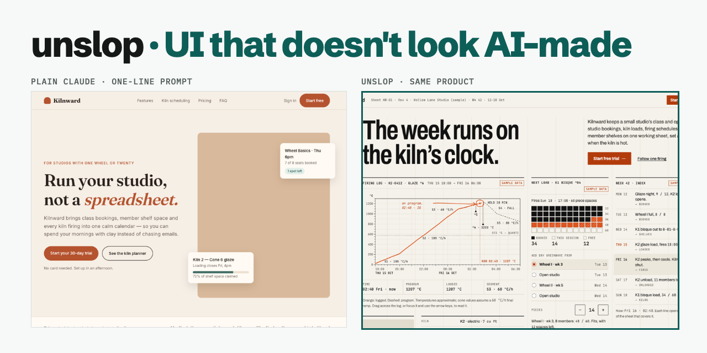

# directionforge

**UI that doesn't look AI-made.** A Claude Code plugin that makes AI-generated UI look designed.



**[See a full run](https://amratansh12.github.io/directionforge/)**: one brief for a fictional ceramic-studio app, built
three ways (a one-line prompt, the full brief, and directionforge), with every direction, iteration and decision.

Ask an AI for a page and you get the usual: purple gradients, glossy blobs, rows of icons with three
words each, rounded everything, Inter everywhere, every colour used at once. That's what happens when
there's nothing to steer it.

directionforge gives it something to steer by:

- **Real references.** Every direction comes from screenshots you or Claude collect, grouped by visual
  style.
- **Several distinct directions.** Each one commits fully to its own look, and none of them blend.
- **Your rules.** You write the *Always* and *Never* lists, and every build has to follow them.
- **Your choices.** Claude stops at every stage until you pick, and never picks for you.
- **No made-up imagery.** Image slots stay empty and correctly sized until real images exist.

## How it works

Your brief goes through four stages, and you pick at every stop:

1. **References.** Claude collects references, or you supply them. They go into an interactive gallery
   grouped by design style (never by feature), and you shortlist 5 styles.
2. **Directions.** Each style is written up as a direction block for you to approve, then built with
   [impeccable](https://impeccable.style) and [tasteskill](https://github.com/Leonxlnx/taste-skill).
   Marketing pages get 10 builds; app screens get 5, from impeccable only. You pick a winner and can
   borrow features from the other builds.
3. **Iterations.** Claude builds 3 named iterations of the winner. You choose pieces from each.
4. **Final.** Claude builds the final UI and writes `DESIGN.md` and a decision log.

Every build follows your **Always** and **Never** guardrails. Builds copy the *feel and intent* of the
references, never their content. No images are generated or sourced: each image slot gets a flat stand-in
with the right size and position, so the real image can be dropped in later without moving anything.

## Install

```sh
claude plugin marketplace add amratansh12/directionforge
claude plugin install directionforge@directionforge
```

Restart Claude Code after installing. To update, run `claude plugin marketplace update directionforge`
and then `claude plugin update directionforge@directionforge`.

To install from a local clone instead, run `claude plugin marketplace add /path/to/directionforge` and then
`claude plugin install directionforge@directionforge`.

## Use

In any project, ask Claude to "run directionforge" or describe the page you want designed. On first run the
plugin checks for impeccable and tasteskill. If one is missing, it shows you the install command and
asks before running it:

```sh
npx -y impeccable install --project --providers=claude -y
npx -y skills add https://github.com/Leonxlnx/taste-skill --skill design-taste-frontend --agent claude-code --copy -y
```

All output goes into `design/` in that project. Nothing is written at the project root except what the
two skills' own installers add (`.claude/`, `skills-lock.json`) and tasteskill's `.taste-skill/` working folder.

```
design/
  brief.md · decisions.md · PRODUCT.md · index.html (switcher) · manifest.js
  references/   gallery.html, screenshots, SOURCES.md
  stage-2/      one folder per direction × skill
  stage-3/      iter-1 … iter-3
  final/
  DESIGN.md
```

To share the result, ask Claude to publish it: directionforge's `publish.py` copies `design/` without the reference screenshots, which belong to their authors; the
published gallery links to each source instead.

`design/decisions.md` records the current stage and what you still need to answer, so a new session
carries on where the last one stopped.

## Requirements

- Python 3.9+ to run the scripts and the local server.
- Node.js to run the two skills' installers and scripts: 18.19+ for impeccable, 22+ for tasteskill's
  browser inspector.
- A Chromium-family browser (Chrome, Edge or Chromium), which tasteskill's inspector uses.

## Credits

directionforge orchestrates two independent skills, which you install separately:
[impeccable](https://impeccable.style) ([pbakaus/impeccable](https://github.com/pbakaus/impeccable)) and
[tasteskill](https://github.com/Leonxlnx/taste-skill) (MIT). It does not bundle either one.

## Develop

```sh
python3 -m unittest discover tests      # script tests
claude plugin validate .                # marketplace manifest
claude plugin validate .claude-plugin/plugin.json
claude plugin validate skills
```

The design spec is in `docs/specs/` and the implementation plan is in `docs/plans/`.

## License

MIT. See [LICENSE](LICENSE).
